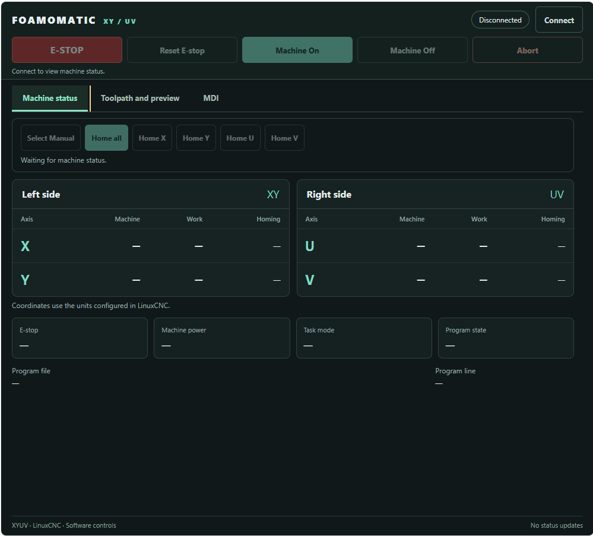
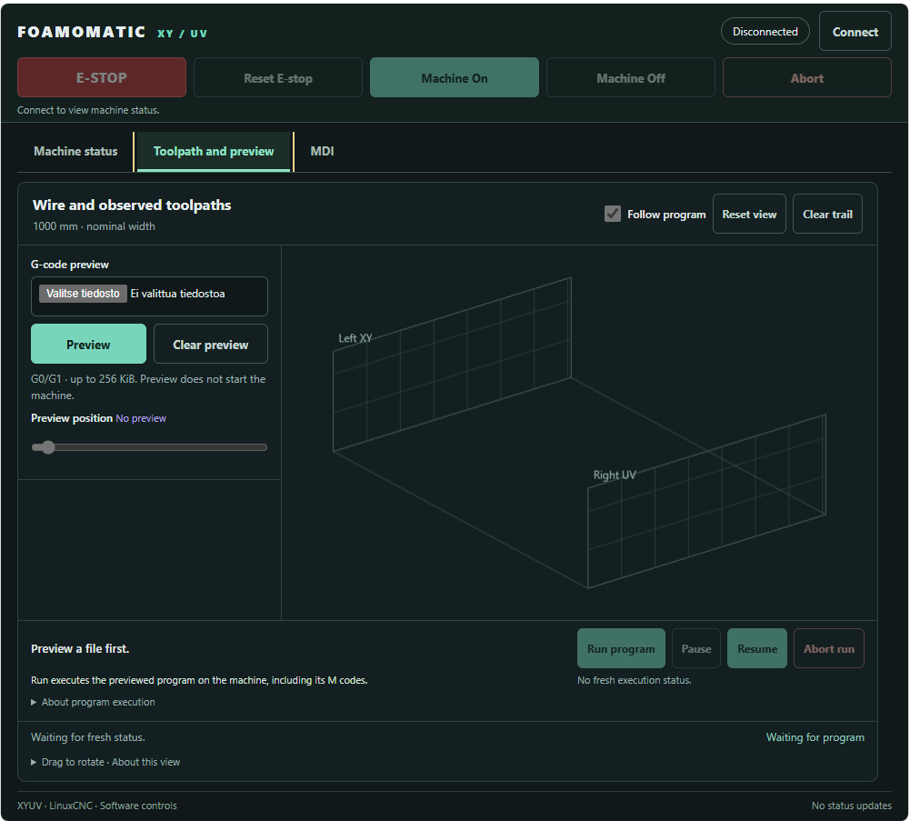
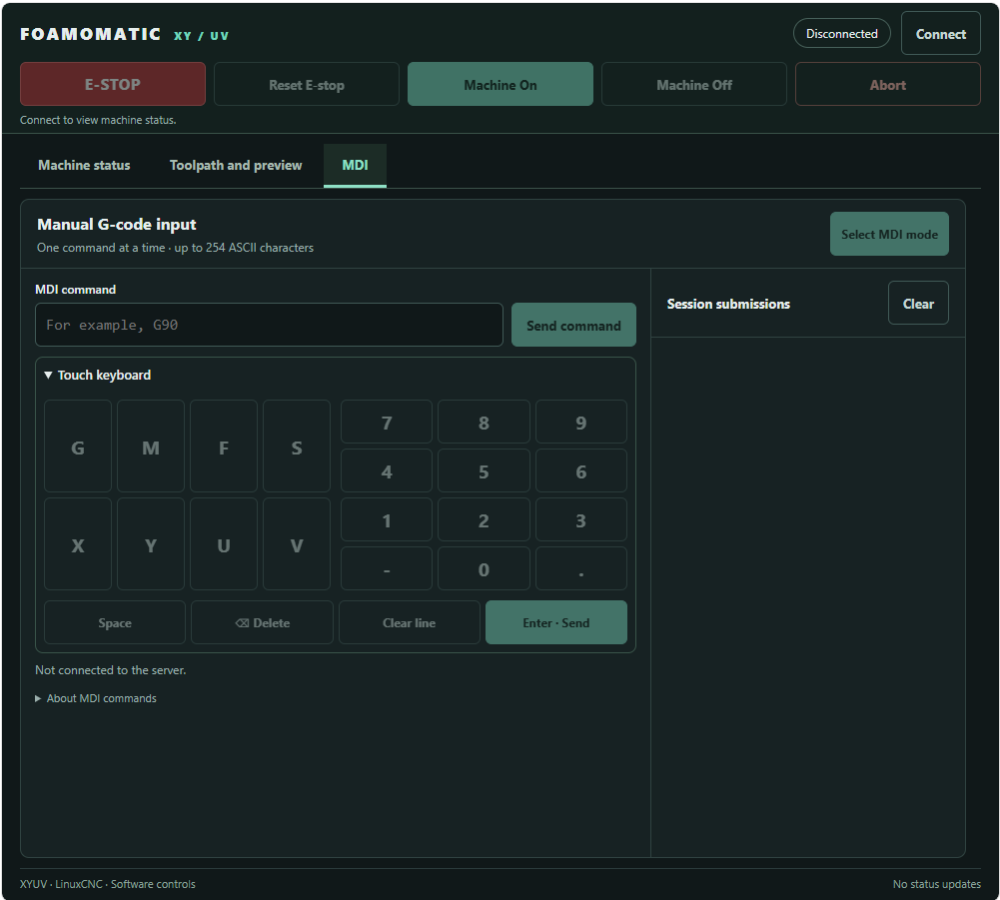
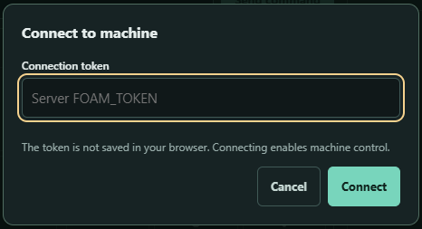

# Foamomatic

## DISCLAIMER — PROOF OF CONCEPT

**Foamomatic is experimental Proof of Concept software. It is not production-ready
and is not a certified machine-safety system. Use it entirely at your own risk.**

Before using Foamomatic, you are expected to have successfully installed and
configured your own hot-wire cutter and verified that it operates correctly
using LinuxCNC's standard AXIS interface. You are also expected to be comfortable
using Linux, including the terminal, configuration files and system services.
Foamomatic assumes an already working LinuxCNC machine configuration.

This software can control machinery, motion and connected equipment. Incorrect
configuration, software defects, communication failures or misuse can cause
unexpected movement, fire, equipment damage, serious injury or death.

To the fullest extent permitted by applicable law, the software is provided
**"AS IS", WITHOUT ANY WARRANTY**, express or implied, including warranties of
merchantability, fitness for a particular purpose, accuracy, reliability or safety.
The authors, copyright holders and contributors accept no responsibility or
liability for any claims, losses, damage, injury, death or other consequences
arising from installing, configuring, using, modifying or distributing the software,
or from being unable to use it. This includes direct, indirect, incidental,
special and consequential damages.

You are solely responsible for assessing suitability, reviewing and validating the
software and configuration, testing on your own equipment, providing appropriate
physical emergency stops, interlocks and independent safeguards, and complying
with applicable requirements. Browser controls, network commands and software
watchdogs do not replace physical machine-safety systems.

No guarantee of maintenance, support, updates or continued availability is made.
Nothing in this disclaimer excludes liability that cannot lawfully be excluded.
The warranty and liability provisions in Sections 15–17 of the GNU GPL version 3
also apply.

## What is Foamomatic?

Foamomatic is an experimental web interface for a LinuxCNC-controlled XYUV
hot-wire foam cutter. It provides machine status, homing, MDI commands, G-code
preview and program execution from a desktop or tablet browser.

The interface is designed for two independently moving wire endpoints:

| Wire endpoint | Horizontal axis | Vertical axis |
| --- | --- | --- |
| Left | X | Y |
| Right | U | V |

The visualization connects those endpoints with a straight wire and displays
the surfaces swept by XYUV moves. Wire sag, stretch and tension are not modeled.
The default 1000 mm display width represents usable stock width, not a fixed
wire length or a measured distance between the towers.

### Screenshots

<table border='0'>
<tr>
<td></td>
<td></td>
<td></td>
<td></td>
</tr>
</table>

## How it works

LinuxCNC and the gateway run on the same Debian host. LinuxCNC remains responsible
for real-time motion and the Mesa interface; Docker serves the browser application.
An optional desktop-session host service waits for the Mesa card and launches
LinuxCNC with the selected INI, keeping AXIS available on the server desktop.

```text
Desktop / tablet browser
        |
        | HTTP + WebSocket, operator LAN
        v
Docker: FastAPI gateway + HTML/CSS/JavaScript interface
        |
        | Unix socket: /run/foamomatic/adapter.sock
        v
Host: Python adapter, supervised by systemd
        |
        | LinuxCNC Python API
        v
LinuxCNC + real-time Mesa driver --> Mesa Ethernet card --> machine
```

The adapter uses the host's LinuxCNC Python modules. It does not run in Docker
or a separate virtual environment. The container needs no LinuxCNC libraries,
privileged mode or host PID/IPC sharing. Its machine connection is a bind mount
of the adapter's socket directory, with access restricted to the operator's UID/GID.

A complete program is uploaded and interpreted on the host before execution.
LinuxCNC then runs the prepared program locally; the browser does not stream
motion commands line by line. Status updates arrive at 5 Hz, so a slow operator
network affects display freshness rather than trajectory timing. Use a dedicated
Ethernet interface for Mesa and a separate interface for operator LAN traffic.

### Features and operating limits

- **Machine Status:** machine/work coordinates, homing state, operating mode,
  interpreter state, errors, individual X/Y/U/V homing and Home All.
- **Persistent header controls:** connection, Machine On/Off, software ESTOP,
  ESTOP Reset and Abort, available above all three tabs.
- **Toolpath and Preview:** live wire position, sampled motion trail, rotatable
  XYUV preview, source-line slider, Run Program, Pause and Resume.
- **Follow program:** highlights progress using the executing source line and
  live position of the matching program. Moving the slider allows manual
  inspection; enabling Follow program returns to execution progress.
- **MDI:** single-line G-code entry, submission history and a touch keyboard.
  Machine enable, homing and interpreter-state checks gate commands.

Preview accepts UTF-8 `.nc` and `.ngc` files up to 256 KiB, with at most 12,000
segments and 20 seconds of interpretation. It uses LinuxCNC's interpreter in an
isolated process, supporting XYUV G0/G1 moves and G93 inverse-time feed programs.
Arcs, probing, rigid tapping and nonzero tool offsets are unsupported;
machine-specific remaps are rejected for execution. Preview does not validate
travel limits or simulate heater M codes. During execution, M codes operate
according to the machine's actual LinuxCNC INI/HAL configuration.

## Installation

### 1. Prepare the Debian host and install Docker

Use a Debian-based LinuxCNC installation with a working, validated four-joint
XYUV INI/HAL configuration. Run the following commands as the same regular user
who operates LinuxCNC. LinuxCNC installation and machine commissioning are
prerequisites; Foamomatic does not configure the Mesa card, homing or motion limits.

If Docker is not installed, install it using Docker's convenience script:

```sh
sudo apt-get update
sudo apt-get install curl
curl -fsSL https://get.docker.com | sh
sudo usermod -aG docker $USER
```

Log out of the desktop/SSH session and log back in to apply group membership.
Then verify Docker and the Compose plugin:

```sh
docker run --rm hello-world
docker compose version
```

See the [Docker Debian installation guide](https://docs.docker.com/engine/install/debian/)
for supported distributions and alternative installation methods, and
[Docker post-installation steps](https://docs.docker.com/engine/install/linux-postinstall/)
for group setup. The convenience script is intended for testing/development;
membership in the `docker` group grants root-level privileges.

### 2. Download Foamomatic

Install Git if needed, then clone the repository into a permanent location:

```sh
sudo apt-get install git
mkdir -p ~/git
cd ~/git
git clone https://github.com/boozeman/foamomatic.git
cd foamomatic
```

Authenticate with your own Git credentials if the repository is private.
Keep this checkout in place: the systemd service uses its absolute path.
The path must not contain whitespace, quotes or backslashes.

Verify that the host's system Python can import the LinuxCNC modules:

```sh
/usr/bin/python3 -c 'import linuxcnc, gcode, rs274; print("LinuxCNC modules available")'
```

These modules come from the LinuxCNC installation, not `pip` or the container.

### 3. Install the host adapter

Leave the machine idle during installation. Install the adapter service from
the repository root (LinuxCNC can be started manually or by the launcher below):

```sh
sudo python3 deploy/install_systemd.py --user "$(id -un)"
systemctl status foamomatic-adapter --no-pager
journalctl -u foamomatic-adapter -n 50 --no-pager
```

The installer checks Python imports as the operator, validates and installs the
systemd unit, and enables/starts the service. It prints the numeric UID/GID needed
in the gateway configuration step. Do not copy the service template directly or run a second
manual adapter alongside the service.

The adapter requires exactly one running `linuxcncsvr` process. If LinuxCNC is
not running yet, systemd retries every five seconds. After LinuxCNC starts,
confirm that `/run/foamomatic/adapter.sock` exists before starting the container.

### 4. Set up Mesa-triggered LinuxCNC startup (optional)

This launcher keeps `[DISPLAY] DISPLAY = axis` in your existing INI. It starts
LinuxCNC in the operator's desktop session when the controller is powered on and
the configured Mesa IPv4 address responds to ping. AXIS remains accessible on
that desktop; Foamomatic connects through the existing adapter.

Log into the server's graphical desktop as the LinuxCNC operator. In a terminal
there, run the installer **without sudo**, replacing the INI path and Mesa IP:

```sh
sudo apt-get install iputils-ping
python3 deploy/install_linuxcnc_launcher.py \
  --ini "$HOME/linuxcnc/configs/foamcutter/foamcutter.ini" \
  --mesa-ip 10.10.10.10
python3 deploy/install_linuxcnc_launcher.py --session-start
systemctl --user status foamomatic-linuxcnc --no-pager
```

Use the actual card address from your HAL configuration, on the dedicated Mesa
interface. The address must respond to ICMP ping. Two consecutive successful
probes, approximately two seconds apart, trigger startup. This is a reachability
check, not verification of firmware, HAL readiness or drive power; LinuxCNC
performs its own hardware initialization. No ping probes are sent while the
launched LinuxCNC process is running.

The installer creates these files under the operator's home directory:

- `~/.config/foamomatic/linuxcnc.json`: selected INI, Mesa address and executable paths.
- `~/.config/systemd/user/foamomatic-linuxcnc.service`: user service.
- `~/.config/autostart/foamomatic-linuxcnc.desktop`: desktop-login startup entry.

The desktop startup entry imports the session's display credentials into the
user service manager. Do not enable this unit as a boot-time system service or
use `sudo systemctl` for it. **A logged-in graphical desktop is required for
AXIS.** For unattended startup after reboot, configure desktop automatic login
for the operator separately; enabling user lingering alone does not create a
graphical session. Logging out or stopping the service can shut down LinuxCNC,
so do either only while the machine is idle.

Normal startup order is: boot Debian, log into the desktop (manually or through
auto-login), then turn on the controller using its physical button. It also
works if the controller is already powered when the desktop session starts.
The launcher does not enable the machine, reset ESTOP, home or start a program.

Closing AXIS or a failed LinuxCNC startup leaves the launcher waiting; it does
not repeatedly reopen windows. Once LinuxCNC has exited, three failed probes
followed by two successful probes allow another launch. Alternatively, while
idle, explicitly retry with `systemctl --user restart foamomatic-linuxcnc`.
A brief network interruption never tells this launcher to stop LinuxCNC.

An existing LinuxCNC process or `/tmp/linuxcnc.lock` blocks a second launch,
including an instance using a different INI. The launcher never deletes locks
or replaces an existing instance. Before manually launching LinuxCNC for
maintenance, stop the launcher while idle:

```sh
systemctl --user stop foamomatic-linuxcnc
```

To change the configured INI/IP, stop the service, rerun the installer with the
new arguments, then run `--session-start` again. To remove automatic startup,
stop the service and remove the three generated files listed above, then run
`systemctl --user daemon-reload`. Manual LinuxCNC startup remains supported
when this optional launcher is not installed.

### 5. Configure the gateway and LAN access

Create your local configuration and generate a connection key:

```sh
cp .env.example .env
python3 -c 'import secrets; print(secrets.token_hex(32))'
id -u
id -g
nano .env
```

Copy the generated key into `FOAM_TOKEN` and use your operator's UID/GID.
For access at `http://linuxcnc.local:8080`, the configuration could be:

```dotenv
FOAM_UID=1000
FOAM_GID=1000
FOAM_BIND_IP=192.168.1.50
FOAM_TOKEN=replace-with-your-generated-key
FOAM_ORIGINS=http://linuxcnc.local:8080

FOAM_VIEW_WIDTH_MM=1000
FOAM_VIEW_HORIZONTAL_MAX_MM=710
FOAM_VIEW_VERTICAL_MAX_MM=260
```

Replace `192.168.1.50` with the host's operator-LAN address, and replace UID/GID
with your actual values. The default bind address in `.env.example` is
`127.0.0.1`, which only allows access from the host itself. Never bind the gateway
to the Mesa interface.

`linuxcnc.local` must resolve to the host from the client device; Docker does
not create that name. It normally requires the host name `linuxcnc` and working
mDNS, for example through Avahi. Alternatively, use the host's IP address in both
the browser URL and `FOAM_ORIGINS`. Origins must match exactly, including scheme,
name and port; multiple allowed origins are comma separated. Use HTTPS/WSS through
a reverse proxy when accessing the interface over untrusted networks.

The three `FOAM_VIEW_*` values only set visualization bounds. Configure actual
travel limits in LinuxCNC. The visualization assumes millimetres. No Docker volume
is needed for these settings: they persist in the host's `.env` file.

### 6. Build and start the container

From the repository root, after the adapter socket is available:

```sh
docker compose up -d --build
docker compose ps
curl http://linuxcnc.local:8080/health
```

Open **http://linuxcnc.local:8080**, press **Connect** and enter `FOAM_TOKEN`.
The key stays in browser memory for the connection and is not saved to browser
storage. Verify that live machine status appears; `/health` only checks the
gateway process, not the adapter or LinuxCNC connection.

The supplied Compose file uses `restart: "no"`, so the gateway does not
start automatically after a host reboot. Power on the controller and let the
desktop launcher start LinuxCNC (or start it manually), wait for the adapter
socket, then run `docker compose up -d`. `/run` is recreated on reboot: if the
container started before the adapter directory was ready, recreate it with
`docker compose up -d --force-recreate` after the socket becomes available.

## Using Foamomatic

1. Log into the server desktop and power on the controller. Wait for LinuxCNC
   and adapter status, then connect and check the machine state. Reset software ESTOP and enable the
   machine when appropriate for your machine's operating procedure.
2. Select Manual mode and home X/Y/U/V individually or use Home All. LinuxCNC's
   INI/HAL configuration defines the actual homing motion and sequencing.
3. For manual commands, open **MDI**, select MDI mode and submit one line.
   The touch keyboard is optional; history is kept only in browser memory.
4. To run a file, open **Toolpath and Preview** and upload it while LinuxCNC is
   idle. Inspect both endpoint paths and the swept surface before pressing
   **Run Program**. Pause/Resume control that program; M0 waits for Resume.
5. Leave **Follow program** enabled to follow execution, or move the preview
   slider to inspect a source line. This only changes the display.

Preview captures the starting position and offsets. Run requires the machine to
remain in that context and all joints to be homed. Moving the machine or changing
offsets requires a new preview. Re-preview before each new run and after an
adapter restart. The adapter opens and executes the same prepared copy that was
previewed; it does not replay an uncertain start request.

Prepared files are stored on the host under
`~/linuxcnc/nc_files/.foamomatic-programs` by default. No additional container
volume is needed. Temporary interpreter files are removed after preview;
obsolete prepared copies from the current service session are pruned on later
previews. Copies left by earlier sessions may be removed while idle if no longer
needed.

Disconnecting the browser does **not** abort an executing program or MDI command.
A leased manual jog stops when its lease expires. Stale status disables ordinary
controls; commands are never automatically retried. Browser ESTOP is a network
command, not a replacement for the physical emergency stop. Independent hardware
watchdog and dedicated heater controls are not implemented.

## Updates and troubleshooting

Update only while the machine is idle. For a full application update:

```sh
git pull --ff-only
sudo systemctl restart foamomatic-adapter
docker compose up -d --build --force-recreate
```

Reload the browser after updating. Adapter-only changes require a service
restart; gateway/UI changes require an image rebuild. Rerun the systemd installer
if the unit, checkout path or operator account changes. If the optional launcher
is installed, stop it before maintenance and restart it afterwards with
`systemctl --user restart foamomatic-linuxcnc`. Launcher source changes need a
user-service restart; template changes require rerunning its installer. Stopping
the launcher also shuts down the LinuxCNC instance it started.

Useful diagnostics:

```sh
systemctl status foamomatic-adapter --no-pager
journalctl -u foamomatic-adapter -f
docker compose logs --tail=100 gateway
# Optional desktop launcher (run as the operator, without sudo):
systemctl --user status foamomatic-linuxcnc --no-pager
journalctl --user -u foamomatic-linuxcnc -f
```

| Symptom | Check |
| --- | --- |
| Browser cannot reach port 8080 | Container state, `FOAM_BIND_IP`, host name resolution and operator-LAN connectivity. |
| Connection is rejected | `FOAM_TOKEN` and the exact browser origin in `FOAM_ORIGINS`. |
| Gateway is healthy but status is unavailable | LinuxCNC, adapter logs, socket directory mount and matching UID/GID. |
| MDI or Run is disabled | Machine enable, ESTOP, all four homed joints, fresh status and interpreter state. |
| AXIS does not start automatically | Desktop login, launcher user-service logs, configured INI/IP, ping response and an existing LinuxCNC lock/instance. |
| UI looks outdated | Rebuild the gateway and hard-refresh the browser. |

The adapter detects LinuxCNC shutdown/restart using process identity and channel
health. It exits on a lost connection, and systemd retries every five seconds.
The adapter itself does not restart LinuxCNC, enable the machine, home axes or
resume commands. The separate optional desktop launcher handles Mesa-triggered
LinuxCNC startup as described in installation step 4.
With the browser connection still open, status recovers through the existing
gateway without a Docker restart. Preview again before starting a new program.
This connection supervisor is separate from a hardware machine-safety watchdog.

## Development and verification

The interface and project documentation use English. Messages forwarded from
LinuxCNC retain the host's configured language.

Python tests use a fake LinuxCNC API unless the optional integration test is
explicitly enabled. In a separate development environment with the gateway
dependencies and `httpx` installed, run:

```sh
python -m unittest discover -s tests -v
node tests/test_control_policy.mjs
node tests/test_program_ui.mjs
node tests/test_wire_geometry.mjs
node tests/test_preview_progress.mjs
```

Real LinuxCNC interpreter integration, Docker deployment and Mesa operation must
be verified on the Debian machine. Check LinuxCNC latency under expected
container/network load, and avoid image builds during cutting.

## License

Foamomatic is licensed under the **GNU General Public License, version 3 only**
(`GPL-3.0-only`). See [LICENSE](LICENSE) for the complete license text, including
the terms for copying, modification and distribution.

Third-party dependencies remain subject to their respective licenses.
